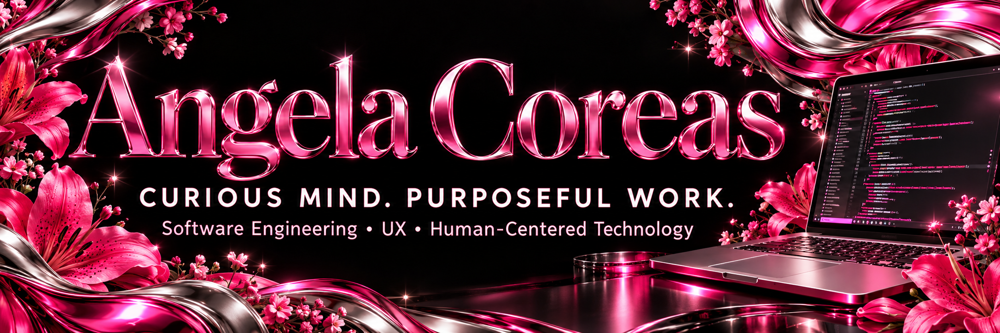

<p align="center">
  
</p>

<h1 align="center">✦ Angela Coreas — Professional Portfolio ✦</h1>

<p align="center">
  A responsive portfolio connecting my experience in customer service,
  operations, and systems support with my growing software engineering
  and user experience skills.
</p>

<p align="center">
  <a href="https://angelacoreas1989-boop.github.io/tech-portfolio/">
    <strong>Open the Live Portfolio</strong>
  </a>
  •
  <a href="https://www.linkedin.com/in/angela-coreas-550088186/">LinkedIn</a>
  •
  <a href="mailto:ostorga.angelac@gmail.com">Contact Me</a>
</p>

---

## ✦ Project Overview

This website gives recruiters, hiring teams, and collaborators one place to explore my projects, professional experience, education, and achievements.

It brings together more than 10 years of experience working with customers, onsite teams, enterprise software, and operational workflows with my continuing education in software engineering.

The portfolio reflects my interest in customer service, customer experience, operations, application support, technical support, UX, product support, and front-end development.

## ✦ Why I Built It

I wanted a portfolio that shows both the work I’m creating and the experience I bring to it.

My background has taught me to listen carefully, adapt to different personalities, investigate problems, and follow through. Those habits influence how I organize information, design customer journeys, and improve the tools I build.

I love learning, learn quickly, and give my all to what I do. This portfolio is a place to document that growth through practical projects and real examples.

## ✦ Features

- Responsive layouts for desktop, tablet, and mobile
- Personalized hot pink, chrome pink, and dark visual design
- Project cards with live demonstrations and repository links
- Professional experience and measurable work achievements
- Education and academic recognition
- Cortland Employee of the Month and Rising Star recognition
- English, Spanish, Italian, and Portuguese proficiency information
- School and personal email links
- Professional references available upon request
- Section navigation and a skip-to-content link
- Visible keyboard focus indicators
- Reduced-motion support

## ✦ Featured Projects

### Portuguese Study Studio

A personalized Brazilian Portuguese learning website with **1,833 study cards across 71 guidebooks**:

| Content | Cards |
| :--- | ---: |
| Vocabulary | 936 |
| Sentences | 590 |
| Grammar | 307 |
| **Total** | **1,833** |

Features include interactive flashcards, browser-powered pronunciation, adjustable speaking speed, search, section and guidebook filters, confidence ratings, Priority Review, progress tracking, and backup/restore.

[Open Portuguese Study Studio](https://angela-portuguese-flashcards.angelacoreas1989.chatgpt.site/)

### Italian Study Studio

A separate Italian learning website with **625 study cards**:

| Content | Cards |
| :--- | ---: |
| Vocabulary | 300 |
| Sentences | 217 |
| Grammar | 108 |
| **Total** | **625** |

Includes interactive flashcards, pronunciation support, search, filtering, confidence ratings, Priority Review, progress tracking, and backup/restore.

Italian and Portuguese content and progress remain independent. Each visitor’s ratings are stored in their own browser.

[Open Italian Study Studio](https://angela-italian-flashcards.angelacoreas1989.chatgpt.site/)

### Interactive World Map

An Angular and TypeScript application that retrieves geographic and economic country information from the World Bank API.

Demonstrates API integration, Angular services, interactive SVG elements, event handling, and dynamic data presentation.

[View Project Showcase](https://github.com/angelacoreas1989-boop/interactive-world-map-showcase)

### Discovering Georgia Tourism Website

A responsive, multi-page tourism website created for WGU’s Front-End Web Development course.

Received a **WGU Excellence Award**. Evaluation faculty praised my wireframes and page layouts for being clean, readable, and clearly organized.

[View Project Showcase](https://github.com/angelacoreas1989-boop/georgia-tourism-website-showcase)

### Magnolia Grove Rental Experience

An apartment-search and rental-application experience inspired by my professional leasing background.

Connects availability, screening requirements, policies, and application steps into an organized customer journey.

[Live Demo](https://angelacoreas1989-boop.github.io/apartment-application-portal/) •
[Repository](https://github.com/angelacoreas1989-boop/apartment-application-portal)

### Leasing Operations Dashboard

An interactive dashboard that simulates applicant search, application review, status filtering, and leasing decisions.

Translates familiar operational workflows into a front-end application.

[Live Demo](https://angelacoreas1989-boop.github.io/leasing-application-portal/) •
[Repository](https://github.com/angelacoreas1989-boop/leasing-application-portal)

### Small-Business Websites

Responsive websites focused on clear service information, visual branding, and customer inquiries.

- [Nicole’s Flower Designs](https://angelacoreas1989-boop.github.io/nicole-flower-designs/)
- [Prime Nails by Fernanda](https://angelacoreas1989-boop.github.io/prime-nails-by-fernanda/)
- [A&S Tires](https://angelacoreas1989-boop.github.io/as-tires/)

## ✦ Technologies

The portfolio website uses:

- HTML
- CSS
- JavaScript
- Git and GitHub
- GitHub Pages

Individual featured projects use additional technologies, including Angular, TypeScript, REST APIs, browser speech synthesis, and localStorage.

## ✦ Design & Development Approach

The portfolio combines expressive pink and chrome visuals with readable text, organized sections, and clear project links.

Content emphasizes both my technical learning and my experience working with people, coordinating workflows, investigating issues, and maintaining accurate information.

I refine my projects through repeated use and feedback, paying attention to navigation, readability, mobile usability, and whether the experience supports the task.

The Study Studios were created using AI-assisted development. I curated the learning content, defined the study requirements, guided the visual design, and provided hands-on feedback to improve the experience.

## ✦ Repository Structure

```text
tech-portfolio/
├── index.html
├── README.md
├── assets/
│   ├── angela-coreas-chrome-banner.png
│   └── project images
├── style.css
└── script.js
```

The current portfolio version embeds its CSS and JavaScript directly in `index.html`.

The separate `style.css` and `script.js` files may remain in the repository, but this version does not load them separately.

## ✦ Run Locally

1. Download or clone this repository.
2. Keep `index.html` and the `assets` folder together.
3. Open `index.html` in a web browser.

No build step or package installation is required.

## ✦ Update the Website

1. Edit `index.html` to change the website’s content.
2. Edit the CSS inside its `<style>` element to change its appearance.
3. Edit the JavaScript inside its `<script>` element to change its behavior.
4. Add or replace images in the `assets` folder.
5. Confirm that image filenames match the paths used in the HTML.
6. Commit changes to the branch configured for GitHub Pages.
7. Check the repository’s Actions tab for deployment status.

**README.md documents the project. The live website is controlled by index.html.**

## ✦ Deployment

Hosted on GitHub Pages:

[https://angelacoreas1989-boop.github.io/tech-portfolio/](https://angelacoreas1989-boop.github.io/tech-portfolio/)

## ✦ Author

**Angela Ostorga Coreas**

Customer Experience • Operations & Systems Support • Software Engineering Student

My background includes more than 10 years of customer-facing and operational experience, bilingual communication, application processing, escalation management, and enterprise systems support.

### Education

- **Bachelor of Science in Software Engineering**  
  Western Governors University — In progress

- **Associate Degree — Criminal Justice / Criminology**  
  Gwinnett Technical College — Completed 2013

### Languages

- English — Fluent
- Spanish — Native / Bilingual
- Italian — Elementary
- Portuguese — Elementary

### Contact

**School Email:** [acorea3@wgu.edu](mailto:acorea3@wgu.edu)  
**Personal Email:** [ostorga.angelac@gmail.com](mailto:ostorga.angelac@gmail.com)

[GitHub Profile](https://github.com/angelacoreas1989-boop) •
[LinkedIn](https://www.linkedin.com/in/angela-coreas-550088186/) •
[Live Portfolio](https://angelacoreas1989-boop.github.io/tech-portfolio/)

**Professional references available upon request.**

---

<p align="center">
  ✦ <strong>Always Curious • Dedicated to Learning • Building with Purpose</strong> ✦
</p>
